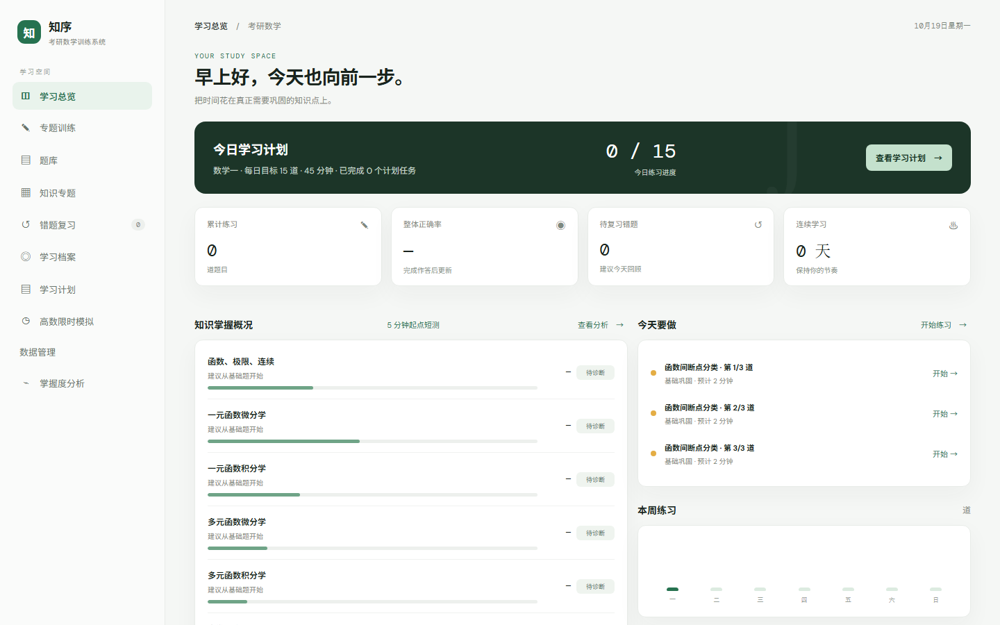
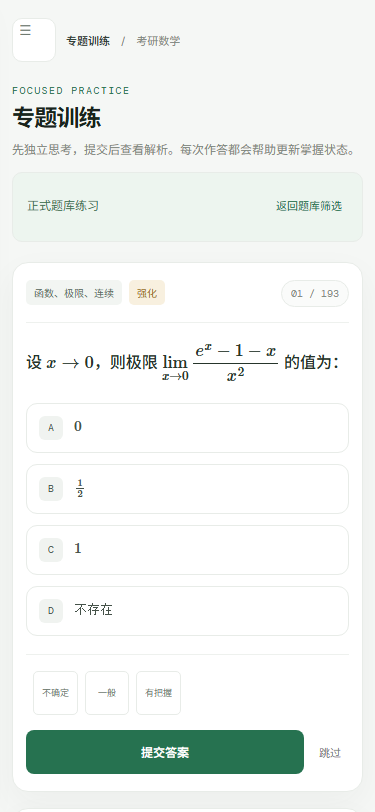
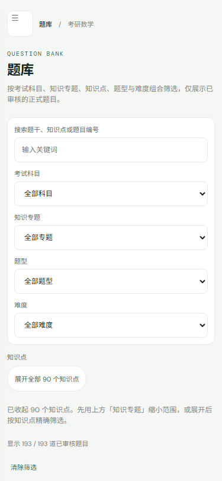
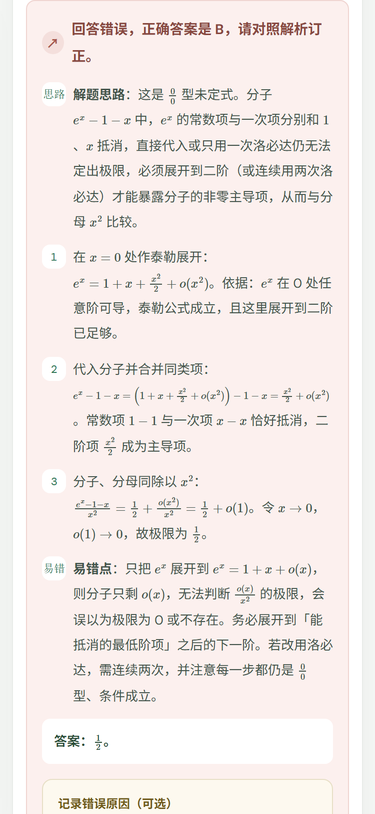

# 知序 · 考研数学训练

一个**本地优先**的考研数学练习单页应用：不用注册、不联网也能做题，学习记录只存在你自己的浏览器里。
自带一套 193 道自有题库（高数），覆盖 8 个专题、90 个知识点。



## 特性

- **零后端**：一个 `index.html` + 一个 `question-bank.js`，双击即可运行
- **知识诊断**：起点短测、按知识点统计正确率/用时/作答信心，样本不足时明确标注「待诊断」而不是硬下结论
- **针对性训练**：按专题/知识点/题型/难度筛选，生成练习队列；错题自动收录并区分「答错 / 跳过 / 存疑」
- **学习计划**：设置每日题量与时间预算，生成当日任务队列，可暂缓、固定
- **限时模拟**：按现行卷面结构（选择 10×5 + 填空 6×5 + 解答 6）组卷计时，交卷后逐题复盘
- **数据自持**：导出/导入 JSON、清除范围可选择、多标签页写入有互斥保护；刷新不丢作答
- **可访问性**：键盘可完成主要操作，正误反馈同时用文字表达而不只靠颜色

| 手机训练 | 知识点筛选 | 交卷后反馈 |
|---|---|---|
|  |  |  |

## 快速开始

```bash
git clone <本仓库地址>
cd <仓库目录>
```

直接双击 `index.html` 即可（两个文件必须放在同一目录）。
若浏览器限制了本地文件，也可以在目录里起一个静态服务器：

```bash
python -m http.server 8000
# 打开 http://localhost:8000
```

> 公式由 MathJax CDN 渲染，需要联网。断网时页面会提示并把公式降级为可读文本，不影响做题。

## 题库

- 193 道题：选择 133 / 填空 35 / 解答 25；难度 基础 92 / 强化 68 / 综合 33
- 90 个知识点覆盖全部 8 个专题，每个知识点都有可用题目
- 全部为本项目自行编写或拥有使用权的自有内容，不含第三方教材的转写题
- 知识点蓝图见 [`出题施工图.md`](出题施工图.md)，题目编写与审核要求见 [`QUESTION_AUTHORING_STANDARD.md`](QUESTION_AUTHORING_STANDARD.md)

题库是数据文件，与页面代码分离：只替换 `question-bank.js` 就能换一套题，页面逻辑不用动。

## 测试

```bash
npm install
npm test          # 离线断言：题库结构、判分、计划、存储、无障碍、窄屏布局等
npm run test:browser   # 真实 Chrome 跑端到端（需本机 Chrome，可设 CHROME_PATH）
```

- 离线部分共 **326 项**断言，覆盖题库内容契约、判分正确性、计划生成、本地存储事务、界面文案与布局
- 浏览器部分 **17 项**，用真实鼠标事件走导航、作答、刷新恢复、窄屏菜单
- 脚本按文件同名约定读取同目录的 `index.html` 与 `question-bank.js`，所以**不要单独移动脚本**

## 目录结构

```
index.html                     页面（样式与脚本内联，无构建步骤）
question-bank.js               题库数据
出题施工图.md                   90 个知识点的题型/用时蓝图
QUESTION_AUTHORING_STANDARD.md 题目编写与审核规范
verify-*.cjs                   题库与界面验收脚本
e2e.cjs / gen-test.cjs         端到端与组卷验收（jsdom）
verify-stage6-browser.cjs      真实浏览器验收（Chrome DevTools Protocol）
scripts/prep.cjs               生成测试用的 latest/ 副本
scripts/run-all.cjs            顺序跑全部离线验收并汇总
```

## 数据与隐私

- 所有作答、错题、计划、模拟记录都保存在浏览器 `localStorage`，**不上传任何服务器**
- 本站没有账号系统，也没有云同步：换设备或清理浏览器数据会导致记录丢失，请用「数据管理」页定期导出备份
- 页面会请求 MathJax 的 CDN 资源，因此不是完全离线；除此之外没有第三方请求
- 多标签页同时写入有互斥与回滚保护，写失败会明确提示而不是静默丢数据

## 已知限制

- 只有高等数学，线性代数与概率论尚未接入
- 没有账号与跨设备同步（设计如此：数据自持）
- 题库筛选依赖全量渲染，题目数量再上一个量级时需要分页或懒加载
- 分数线/掌握度都是基于样本的可解释估算，样本不足时会明确标注，不作为结论

## 许可证

- 代码（HTML/CSS/JS 与验收脚本）：[MIT](LICENSE)
- 题库内容（`question-bank.js` 中的题干、选项、答案与解析）：CC BY 4.0，转载请署名并注明来源

## 参与

欢迎提 Issue 说明题目错误、界面问题或功能建议。提交改动前请先跑 `npm test` 与 `npm run test:browser`。
